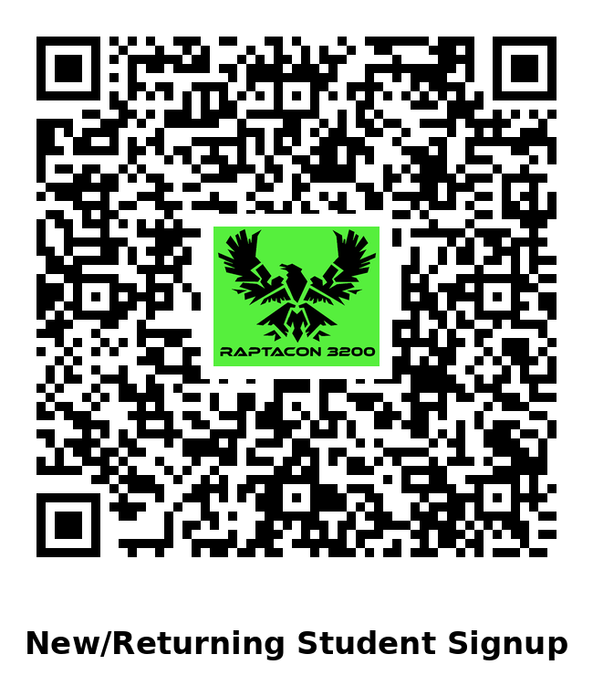
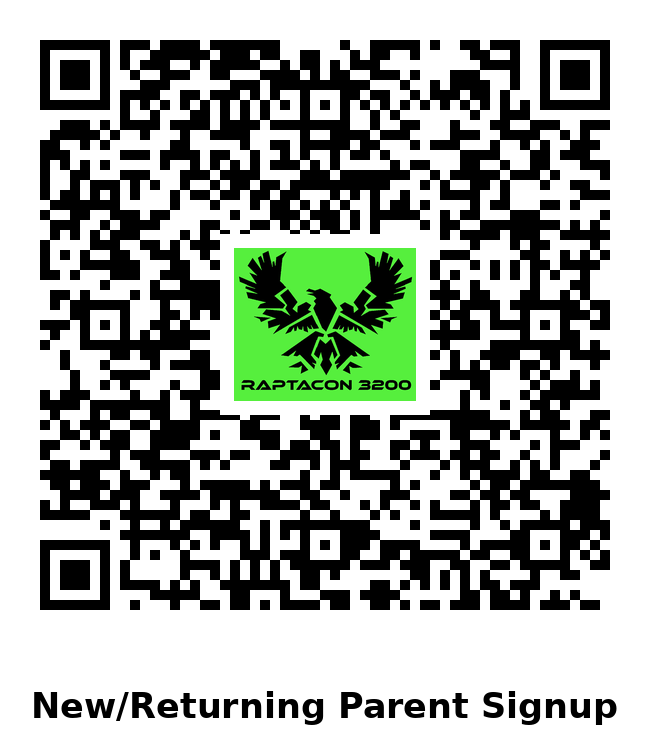
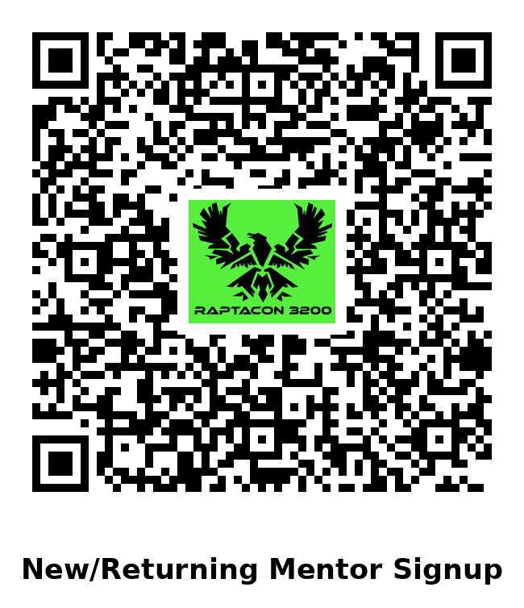
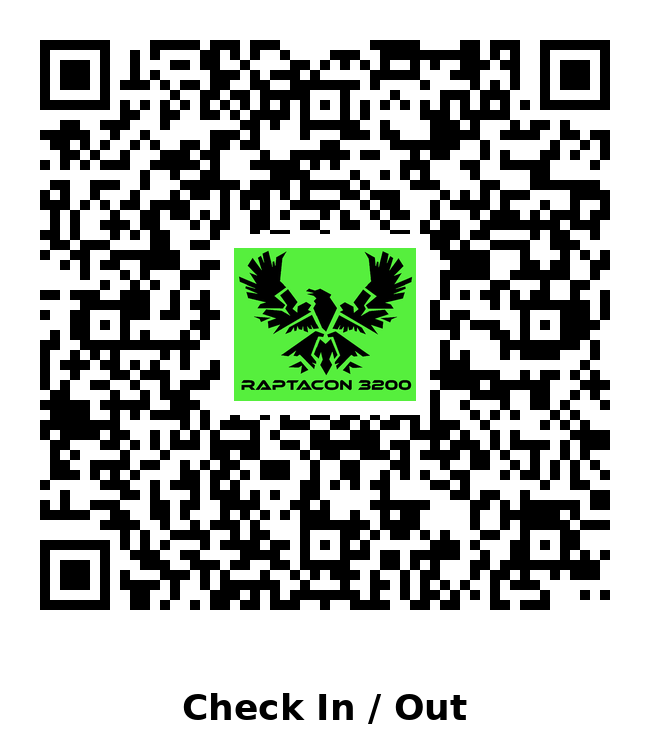
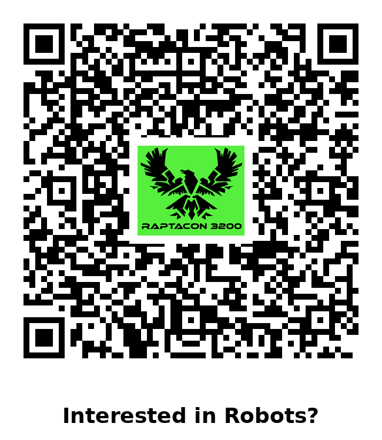
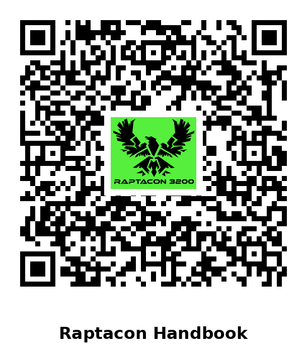
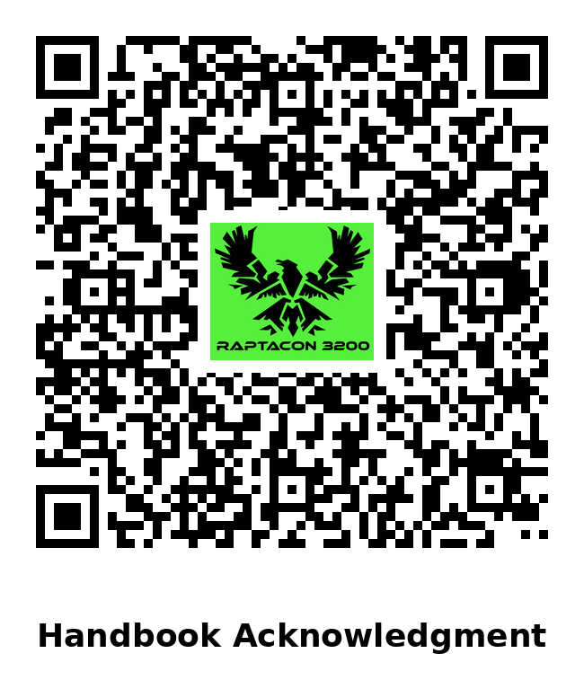
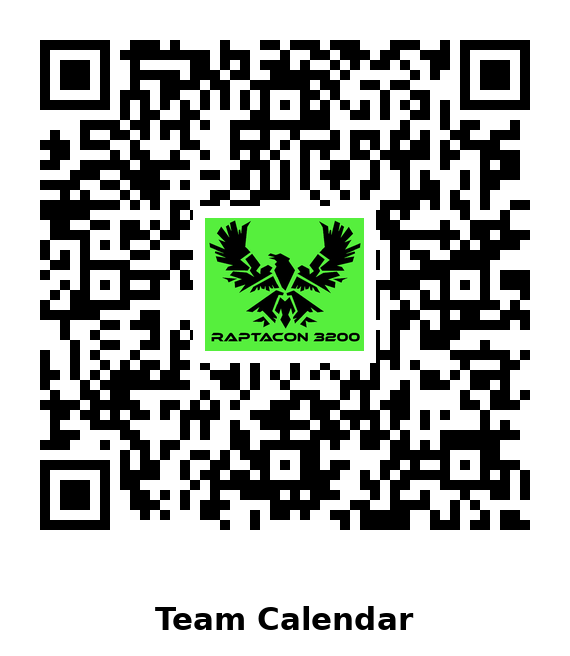
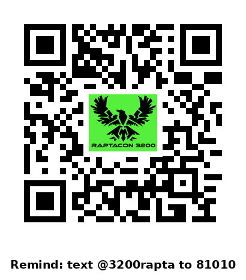
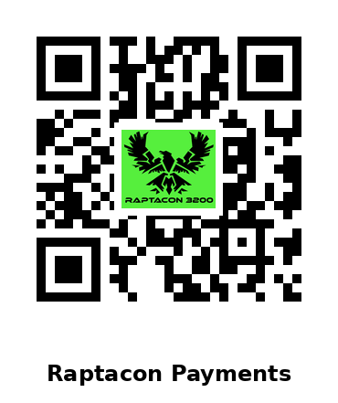

# Ready-made QR codes

Print-ready Raptacon 3200 QR codes, one per named target in
[`../Makefile`](../Makefile). Click a code to open the PNG, then download it.

To change a link, see [Ready-made codes](../README.md#ready-made-codes).

| Code | QR | Make target |
|------|----|-------------|
| Student sign-up |  | `student_signup` |
| Parent sign-up |  | `parent_signup` |
| Mentor/Volunteer sign-up |  | `mentor_volunteer_signup` |
| Check in / out |  | `attendance_checkin_checkout` |
| Interest form |  | `raptacon_interest_signup` |
| Handbook |  | `raptacon_handbook` |
| Handbook acknowledgment |  | `handbook_ack` |
| Team calendar |  | `team_calendar` |
| Discord |  | `raptacon_discord_signup` |
| Remind |  | `remind_signup` |
| Payments |  | `raptacon_payments` |
